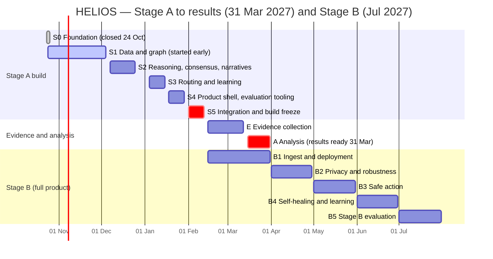
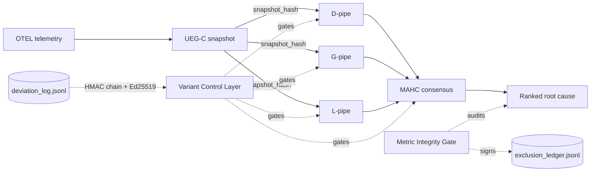

# HELIOS — Live Dashboard

_Manual until a weekly CI job regenerates the dynamic sections. Refreshed at every sprint exit (see `docs/sprints/README.md`)._

**Last updated:** 2026-10-24 (S0 exit documentation sync; replaces the May 2026 stage plan)

## Sprint progress (manual)

Plan: `docs/tracking/helios_e2e_product_plan_2026-10.md`; sprint plans and exit reports: `docs/sprints/`.

| Sprint | Status | Exit |
|---|---|---|
| S0 Foundation | Closed 2026-10-24 | `rb-s0-exit`; [exit report](../sprints/s0-foundation/exit_report.md) |
| S1 Data and graph | In progress (started 2026-10-24, early) | — |

## Architecture flow (manual; updated when ablation_architecture.md changes)

## Evidence grid (phase E; empty until 15 Feb 2027)

Confirmatory pool: 240 RCAEval cases (RE2-OB, RE2-TT, RE3-OB, RE3-TT), sealed in S1.1. Each cell counts cases run or formally excluded; a cell enters inference only with at least 80% of its cases.

| System | RE2-OB | RE2-TT | RE3-OB | RE3-TT |
|---|---|---|---|---|
| 8 confirmatory variants (Family A) | ⏳ | ⏳ | ⏳ | ⏳ |
| 5 baselines B1–B5 (Family B) | ⏳ | ⏳ | ⏳ | ⏳ |
| Exploratory variants (Family E) | ⏳ | ⏳ | ⏳ | ⏳ |

Legend: ✅ ≥80% complete · 🟡 partial · ⏳ not yet started · ❌ blocked

## Integrity snapshot (manual)

| Invariant | Status | Evidence (as of 2026-10-24 unless stated) |
|---|---|---|
| Deviation log (HMAC chain + Ed25519) | ✅ | 38 entries; `verify-public` passes with the public key only; entries from 35 Ed25519-signed |
| Reconciliation ledger | ✅ | 25 entries; chain and anchor verified |
| Exclusion ledger | ✅ (empty) | Anchor present; populated from phase E |
| Capture content seals | ✅ | 20 exploratory OTel captures; `verify_captures.py` passes |
| VCL variants | ✅ | 15 variants (8 confirmatory, 7 exploratory), unique hashes; confirmatory hashes identical to OSF deposit 1 (`vcl_manifest_tracking.md`) |
| OSF freeze | ✅ | Deposit 1, DOI 10.17605/OSF.IO/KMR3D; `verify_osf_freeze.py --verify` passes |
| Seed register | ✅ | 10,000,000–10,009,999, layout hash pinned (`seed_register.md`) |
| Tracker schema | ✅ | Validator in pre-commit and CI over every commit (`--range`) |
| DisjointnessAuditor | 🟡 | As of M4 (2026-05-21): 5 flags covered, 0 violations; re-certified for all 16 boolean flags in S5.2 |
| Snapshot hash registry | ✅ (empty) | `data/snapshot_registry.jsonl` was reset on purpose when the 20 incidents were re-captured (commit `b24955c`, May 2026); runs recreate it (`bin/helios_run.py` default path). Checked in S1.1 |

## Latest deviation log entries (manual)

*Source: `deviation_log.jsonl` — 38 entries; 6 most recent shown. Full text: `deviation_log.md`.*

| # | Date | Change (short) | sig[:12] |
|---|---|---|---|
| 33 | 2026-10-24 | Metric contract; cpr renamed mrr | `3bbedb34eef6` |
| 34 | 2026-10-24 | Binding seed register 10,000,000–10,009,999 | `5f66223c8394` |
| 35 | 2026-10-24 | Ed25519 signatures on the deviation log; audit step E | `dc0af094444b` |
| 36 | 2026-10-24 | Chair call outcome: baselines B1–B5, CHASE value | `b468a44e2c78` |
| 37 | 2026-10-24 | OSF deposit 1, DOI 10.17605/OSF.IO/KMR3D | `67070970b2ed` |
| 38 | 2026-10-24 | Rating rubric deposited at OSF deposit 2 | `77e90d75e0ef` |
