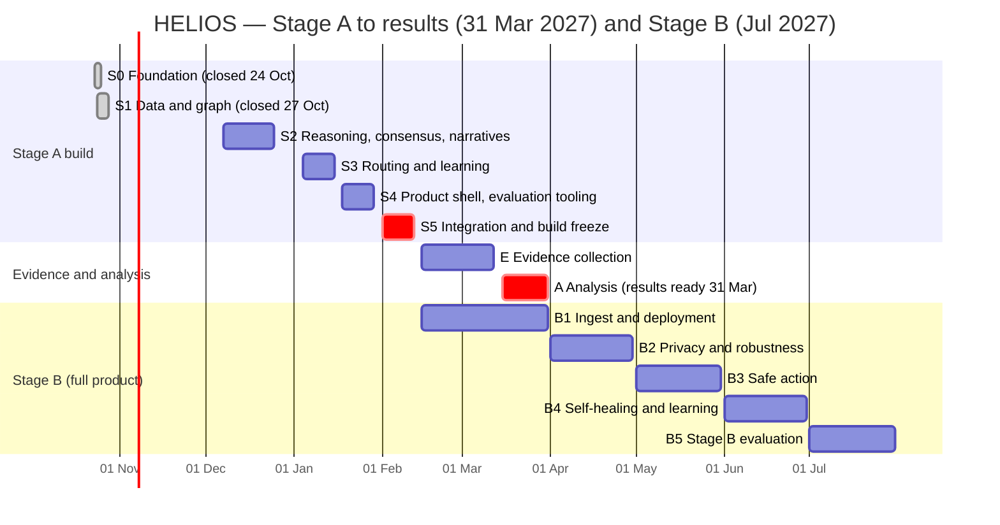
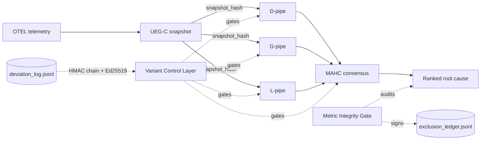

# HELIOS — Live Dashboard

_Manual until a weekly CI job regenerates the dynamic sections. Refreshed at every sprint exit (see `docs/sprints/README.md`)._

**Last updated:** 2026-10-27 (S1 exit documentation sync)

## Sprint progress (manual)

Plan: `docs/tracking/helios_e2e_product_plan_2026-10.md`; sprint plans and exit reports: `docs/sprints/`.

| Sprint | Status | Exit |
|---|---|---|
| S0 Foundation | Closed 2026-10-24 | `rb-s0-exit`; [exit report](../sprints/s0-foundation/exit_report.md) |
| S1 Data and graph | Closed 2026-10-27 (started early, 2026-10-24) | `rb-s1-exit`; [exit report](../sprints/s1-data-graph/exit_report.md) |
| S2 Reasoning, consensus, narratives | Next (plan refreshed at the S1 exit) | — |

## Architecture flow (manual; updated when ablation_architecture.md changes)

## Evidence grid (phase E; empty until 15 Feb 2027)

Confirmatory pool: 240 RCAEval cases (RE2-OB, RE2-TT, RE3-OB, RE3-TT), sealed in S1.1. Each cell counts cases run or formally excluded; a cell enters inference only with at least 80% of its cases.

| System | RE2-OB | RE2-TT | RE3-OB | RE3-TT |
|---|---|---|---|---|
| 8 confirmatory variants (Family A) | ⏳ | ⏳ | ⏳ | ⏳ |
| 5 baselines B1–B5 (Family B) | ⏳ | ⏳ | ⏳ | ⏳ |
| Exploratory variants (Family E) | ⏳ | ⏳ | ⏳ | ⏳ |

Legend: ✅ ≥80% complete · 🟡 partial · ⏳ not yet started · ❌ blocked

## Integrity snapshot (manual)

| Invariant | Status | Evidence (as of 2026-10-27 unless stated) |
|---|---|---|
| Deviation log (HMAC chain + Ed25519) | ✅ | 45 entries; `verify-public` passes with the public key only; entries 35–45 Ed25519-signed |
| Reconciliation ledger | ✅ | 25 entries; chain and anchor verified |
| Exclusion ledger | ✅ (empty) | Anchor present; populated from phase E |
| Capture content seals | ✅ | 20 exploratory OTel captures (`verify_captures.py`); RCAEval 240 pool + 495 build sealed (S1.1); 63 OTel build cases (`capture_campaign.py verify`, S1.2) |
| VCL variants | ✅ | 15 variants (8 confirmatory, 7 exploratory), unique hashes; confirmatory hashes identical to OSF deposit 1 (`vcl_manifest_tracking.md`) |
| OSF freeze | ✅ | Deposit 1, DOI 10.17605/OSF.IO/KMR3D; `verify_osf_freeze.py --verify` passes |
| Seed register | ✅ | 10,000,000–10,009,999, layout hash pinned (`seed_register.md`) |
| Tracker schema | ✅ | Validator in pre-commit and CI over every commit (`--range`) |
| Label leakage | ✅ | Opaque IDs (S1.1); `tests/evaluation/test_no_ground_truth_leak.py` scans the run path and traps label reads at run time (S1.9) |
| DisjointnessAuditor | 🟡 | As of M4 (2026-05-21): 5 flags covered, 0 violations; re-certified for all 16 boolean flags in S5.2 |
| Snapshot hash registry | ✅ (empty) | `data/snapshot_registry.jsonl` was reset on purpose when the 20 incidents were re-captured (commit `b24955c`, May 2026); runs recreate it (`bin/helios_run.py` default path). Checked in S1.1 |

## Latest deviation log entries (manual)

*Source: `deviation_log.jsonl` — 45 entries; 6 most recent shown. Full text: `deviation_log.md`.*

| # | Date | Change (short) | sig[:12] |
|---|---|---|---|
| 40 | 2026-10-26 | K-hop pruner (Algorithm 5), K = 3, top-n = 50, 50-node floor | `daaadbfbc9f4` |
| 41 | 2026-10-26 | Verdict contract, PipelineVerdict schema-draft-v0.5 | `c18f15184f03` |
| 42 | 2026-10-26 | Price book price-book-v1, five-component CpR | `bde2a2b267e2` |
| 43 | 2026-10-26 | Price book price-book-v2, AWS / GCP / Azure profiles | `7ab2dd0ba7e2` |
| 44 | 2026-10-26 | OTel Demo build corpus and capture protocol | `b28bb3faa2d1` |
| 45 | 2026-10-26 | Jaeger span service-label defect fixed (May captures affected) | `32297014b287` |
